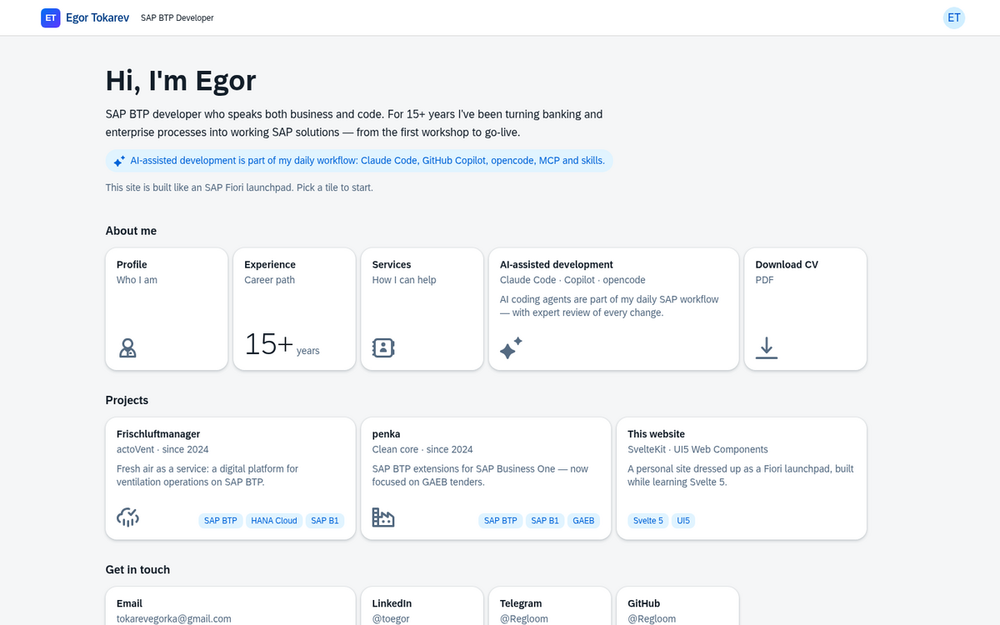
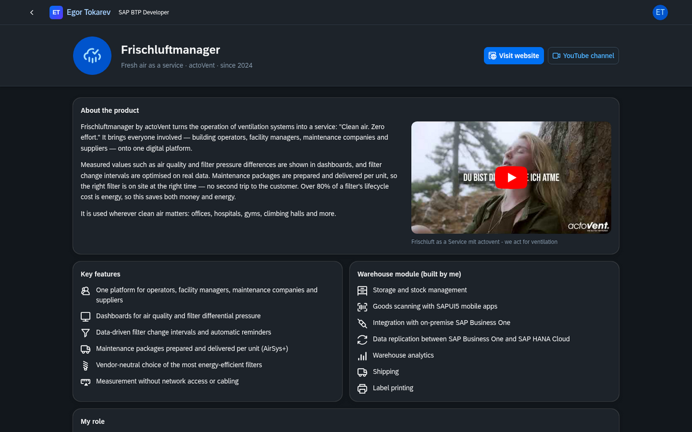

# toegor.app

Personal site of Egor Tokarev, SAP BTP full-stack developer and architect. It is built to look and feel
like an **SAP Fiori launchpad** (Horizon theme), using [UI5 Web Components](https://ui5.github.io/webcomponents/)
on top of **SvelteKit 3 / Svelte 5**.

**Live:** [toegor.app](https://toegor.app)



## Features

- **Launchpad home** with tile groups and a GenericTile look-alike (`src/lib/components/Tile.svelte`):
  icon, KPI and wide tiles with description and tags
- **"Apps" behind the tiles:** profile, experience timeline, services, and project pages
- **Light / dark / system theme** with SAP Horizon (`sap_horizon`, `sap_horizon_dark`, `sap_horizon_auto`)
- **English and Russian**, chosen from a cookie or the browser's `Accept-Language`
- **Server-rendered preferences:** theme and language are read from cookies in `hooks.server.js` and
  written into `<html>` and the UI5 boot config, so the page never flashes the wrong theme or language
- **SEO:** per-page title and description, canonical and `hreflang` links (`?lang=ru` gives each language
  its own URL), Open Graph / Twitter cards with `static/og-image.png`, JSON-LD `Person` + `WebSite`,
  `robots.txt` and a generated `/sitemap.xml`
- **Privacy-friendly video:** YouTube embeds load only after a click, via `youtube-nocookie.com`
- **Small bundle:** only the UI5 components and icons in use are imported (`src/lib/ui5.js`)



## Stack

| | |
| --- | --- |
| Framework | SvelteKit 3, Svelte 5 (runes), Vite 8 |
| UI | UI5 Web Components 2 (`@ui5/webcomponents`, `-fiori`, `-icons`), SAP Horizon theme |
| Server | `@sveltejs/adapter-node`, Node 24 |
| Delivery | Docker image built by GitHub Actions, pushed to GHCR, deployed with CapRover |

## Development

```sh
npm install
npm run dev      # http://localhost:5173
npm run build    # production build in ./build
node build       # run the production build (PORT defaults to 3000)
```

Docker: `docker build -t webc-site .` — the [GitHub workflow](.github/workflows/build.yml) builds the image on
every push to `main`, pushes it to GHCR and deploys it to CapRover.

## Where things live

| What | Where |
| --- | --- |
| All texts (EN / RU) | `src/lib/i18n/en.js`, `src/lib/i18n/ru.js` |
| Contacts, CV path, theme and language lists | `src/lib/config.js` |
| Project data (links, tags, videos) | `src/lib/projects.js` |
| Launchpad tiles and groups | `src/routes/+page.svelte` |
| Project pages | `src/routes/projects/[slug]/` |
| Theme and language state | `src/lib/settings.svelte.js` (context), `src/hooks.server.js` (cookies to SSR) |
| UI5 components and icons in use | `src/lib/ui5.js` |

**Add a tile:** add an entry to a group in `src/routes/+page.svelte`, its title and subtitle under `tiles` in
both dictionaries, and import its icon in `src/lib/ui5.js`.

**Add a project:** add an entry to `src/lib/projects.js`, its texts under `projects.<slug>` in both
dictionaries, and a tile pointing to `/projects/<slug>`.

## Built with AI

The site was redesigned with [Claude Code](https://claude.com/claude-code), using the official
[Svelte MCP server and skills](https://github.com/sveltejs/ai-tools) for documentation lookup and
`svelte-autofixer` checks.

## License

The **source code** is available under the [MIT License](LICENSE) — feel free to use it as a starting point
for your own Fiori-style site.

The **content** is not covered by the license: texts, the CV (`static/Egor_Tokarev_CV.pdf`), personal and
contact details, and project descriptions belong to Egor Tokarev, and product names, logos and videos belong
to their respective owners. Please replace them with your own.
